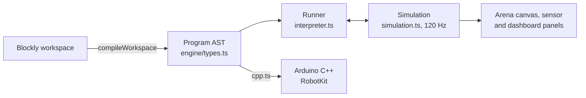

# Simulator

The simulator is one page per language where a student builds a program with blocks, runs it on a
virtual track, and reads the Arduino C++ it becomes. It is the Next.js app in `apps/simulator` and
reads the mission titles and learning-path places from `@dctedu/catalog`.

## Stack

| Part | Choice |
|---|---|
| Framework | Next.js 16, App Router, `output: 'standalone'`, one prerendered page per locale |
| Blocks | Blockly 13, its media copied into `public/blockly-media` by `scripts/copy-blockly-media.mjs` |
| Rendering | Canvas 2D for the arena; React 19 and Tailwind CSS 4 for the panels |
| Theme | `@dctedu/ui` tokens, light and dark (next-themes), dark meant for projectors |
| Languages | next-intl 4, `/id` and `/en`; block text comes from the same message files |
| Tests | Vitest: every mission's reference solution, the interpreter, codegen, messages |

## From blocks to motion and to C++

- **Blocks** (`features/blocks/definitions.ts`) define the toolbox per robot: Ciko gets turn
  signals, Momo gets the servo, the five-sensor line array, environment sensors, and telemetry.
- **Compile** (`compile.ts`) turns the workspace into a `Program`: statements (`drive`, `motors`,
  `repeat`, `if`, `face`, `signal`, `servo`, `send`, ...) and expressions (numbers, sensors,
  variables, comparisons, logic, maths). Each statement keeps its block id, so the running block
  is highlighted.
- **Runner** (`interpreter.ts`) executes the program as a generator: waits and loops yield, like a
  microcontroller's `loop()`, so the simulation advances between them.
- **Simulation** (`simulation.ts`) steps the physics at a fixed 120 Hz: differential drive with
  each robot's wheel base, top speed, and motor bias; line sensors sampled against the taped
  paths; a sonar cone against walls, boxes, and moving hands; the buzzer, OLED, signals, servo,
  Wi-Fi, scripted claps, and environment timelines.
- **Codegen** (`codegen/cpp.ts`) prints the same program as Arduino C++ for the RobotKit library:
  `#include <RobotKit.h>`, `RobotKit robot(RobotKit::CIKO);`, and the program in `setup()`.

## Robots

`engine/robots.ts` holds the two models in centimetres:

| | Ciko | Momo |
|---|---|---|
| Body | 16 x 13 cm, 30 cm/s | 18 x 14 cm, 40 cm/s |
| Line sensors | 2 IR, straddling the tape | 5-in-1 array |
| Distance | Sonar in the bumper, 2 m | Sonar on a servo, 3 m |
| Motors | Matched | Right motor 6 % weaker until calibrated |
| Extras | Turn signals ticking on the buzzer, OLED face | Servo, temperature, humidity, sound, Wi-Fi telemetry |

## Missions

`engine/missions.ts` defines 20 missions (11 Ciko, 9 Momo). A mission has an arena (size, taped
lines, boxes, zones, moving hands), a start pose, a time limit, whether a bump fails it, goals, a
hint, a starter program, and a reference `solution`. A goal is a check over a snapshot of the run
(pose, sensors, face, beeps, signals, telemetry, zones visited); final goals are judged once the
robot settles. The outcome is success, or a failure with its reason (time ran out, a bump, or
goals left unfinished), shown in the result dialog.

Titles, briefs, and the order of missions come from `packages/catalog/src/sim-missions.ts`; each
mission's place on a learning path (`missionStep`) gives the "step n of N" label and the link back
to `https://<store>/<locale>/learn/<robot>#<step>`.

## The screen

`features/ui/sim-app.tsx` reads `?robot=` and `?mission=`, and switches robot and mission.
`mission-screen.tsx` places the workspace next to the brief and goals, the controls (run, stop,
reset, speed 1x, 2x, 4x, restore the starter), the arena canvas with a follow camera, the sensor
panel, the dashboard panel when the mission uses Wi-Fi, and the C++ panel.

## Blockly and Tailwind

Blockly hides parts of its SVG with the `display="none"` attribute, the flyout's scrollbar among
them once the flyout closes. Tailwind's preflight sets `svg { display: block }`, and any CSS rule
beats a presentation attribute, so `src/app/globals.css` puts `display: none` back for those
elements inside Blockly's injection div. Without it the closed flyout's scrollbar stays on the
workspace as a grey line after a block is dragged out.

## Arena banners

`scripts/arena-banners.ts` (`pnpm arena:pdf`) draws the arena banners sold in the store as
print-ready PDFs in `print/`: `arena-ciko.pdf` and `arena-momo.pdf`, each the arena of that
robot's Arena challenge mission at full size, 200 × 140 cm, in vector.

- `ciko-arena`: a figure eight crossing square in the middle, a tight pocket, and a chicane;
  one lap in 70 seconds. The two-sensor line program finishes it at a speed of 35.
- `momo-arena`: a hairpin, two zigzags, steps, near-sharp corners, and a square crossing; one
  lap in 32 seconds, which takes raising the speed and the proportional gain together (the
  reference runs at 60 with a gain of 0.5).

Both tracks are `cornerTrack`s (`geometry.ts`): straight runs between corners, each rounded to
its own radius, so they close on themselves and can cross square. The tape, start pose, zones,
and time limit come from `missions.ts`, and the tests run each reference solution, so the
banner never drifts from a mission that can be finished: change the track and run the script
again. On paper only the tape is dark; zones, labels, and the start mark are pale and kept off
the tape, so a real robot's infrared sensors read nothing but the line. The page is the banner
itself; the print shop prints it at 100 % and adds any bleed or eyelets.

## Storage

Nothing leaves the browser. Each mission's blocks are saved under `dctedu-sim:<mission>` and the
finished missions under `dctedu-sim:done` in `localStorage`, guarded so a blocked storage only
means starting fresh.

## Configuration

| Variable | Purpose |
|---|---|
| `NEXT_PUBLIC_STORE_URL` | The store's address, for the header link and "see this step" links |
