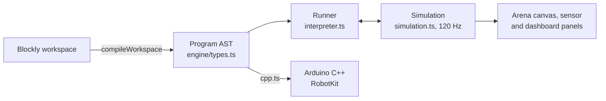

# Architecture

The simulator is one page per language where a student builds a program with blocks, runs it on a
virtual track, and reads the Arduino C++ it becomes. It lives at `apps/sim` in the
[TaksuTech](https://github.com/DarmawanWeb/TaksuTech) workspace and reads the mission
titles and learning-path places from `@dctedu/catalog`.

## Stack

| Part | Choice |
|---|---|
| Framework | Next.js 16, App Router, `output: 'standalone'`, one prerendered page per locale |
| Blocks | Blockly 13, its media copied into `public/blockly-media` by `scripts/copy-blockly-media.mjs` |
| Rendering | Canvas 2D for the arena; React 19 and Tailwind CSS 4 for the panels |
| Theme | `@dctedu/ui` tokens, light and dark (next-themes), dark meant for projectors |
| Languages | next-intl 4, `/id` and `/en`; block text comes from the same message files |
| Tests | Vitest: every mission's reference solution, the interpreter, codegen, messages |

## From blocks to motion and to C++

- **Blocks** (`features/blocks/definitions.ts`) define the toolbox per robot: Ciko gets turn
  signals, Momo gets the servo, the five-sensor line array, environment sensors, and telemetry.
- **Compile** (`compile.ts`) turns the workspace into a `Program`: statements (`drive`, `motors`,
  `repeat`, `if`, `face`, `signal`, `servo`, `send`, ...) and expressions (numbers, sensors,
  variables, comparisons, logic, maths). Each statement keeps its block id, so the running block
  is highlighted.
- **Runner** (`interpreter.ts`) executes the program as a generator: waits and loops yield, like a
  microcontroller's `loop()`, so the simulation advances between them.
- **Simulation** (`simulation.ts`) steps the physics at a fixed 120 Hz: differential drive with
  each robot's wheel base, top speed, and motor bias; line sensors sampled against the taped
  paths; a sonar cone against walls, boxes, and moving hands; the buzzer, OLED, signals, servo,
  Wi-Fi, scripted claps, and environment timelines.
- **Codegen** (`codegen/cpp.ts`) prints the same program as Arduino C++ for the RobotKit library:
  `#include <RobotKit.h>`, `RobotKit robot(RobotKit::CIKO);`, and the program in `setup()`.

## Robots

`engine/robots.ts` holds the two models in centimetres:

| | Ciko | Momo |
|---|---|---|
| Body | 16 x 13 cm, 30 cm/s | 18 x 14 cm, 40 cm/s |
| Line sensors | 2 IR, straddling the tape | 5-in-1 array |
| Distance | Sonar in the bumper, 2 m | Sonar on a servo, 3 m |
| Motors | Matched | Right motor 6 % weaker until calibrated |
| Extras | Turn signals ticking on the buzzer, OLED face | Servo, temperature, humidity, sound, Wi-Fi telemetry |

## Missions

`engine/missions.ts` defines 18 missions (10 Ciko, 8 Momo). A mission has an arena (size, taped
lines, boxes, zones, moving hands), a start pose, a time limit, whether a bump fails it, goals, a
hint, a starter program, and a reference `solution`. A goal is a check over a snapshot of the run
(pose, sensors, face, beeps, signals, telemetry, zones visited); final goals are judged once the
robot settles. The outcome is success, or a failure with its reason (time ran out, a bump, or
goals left unfinished), shown in the result dialog.

Titles, briefs, and the order of missions come from `packages/catalog/src/sim-missions.ts`; each
mission's place on a learning path (`missionStep`) gives the "step n of N" label and the link back
to `https://<store>/<locale>/belajar/<robot>#<step>`.

## The screen

`features/ui/sim-app.tsx` reads `?robot=` and `?mission=`, and switches robot and mission.
`mission-screen.tsx` places the workspace next to the brief and goals, the controls (run, stop,
reset, speed 1x, 2x, 4x, restore the starter), the arena canvas with a follow camera, the sensor
panel, the dashboard panel when the mission uses Wi-Fi, and the C++ panel.

## Storage

Nothing leaves the browser. Each mission's blocks are saved under `taksu-sim:<mission>` and the
finished missions under `taksu-sim:done` in `localStorage`, guarded so a blocked storage only
means starting fresh.

## Configuration

| Variable | Purpose |
|---|---|
| `NEXT_PUBLIC_WEB_URL` | The store's address, for the header link and "see this step" links |
